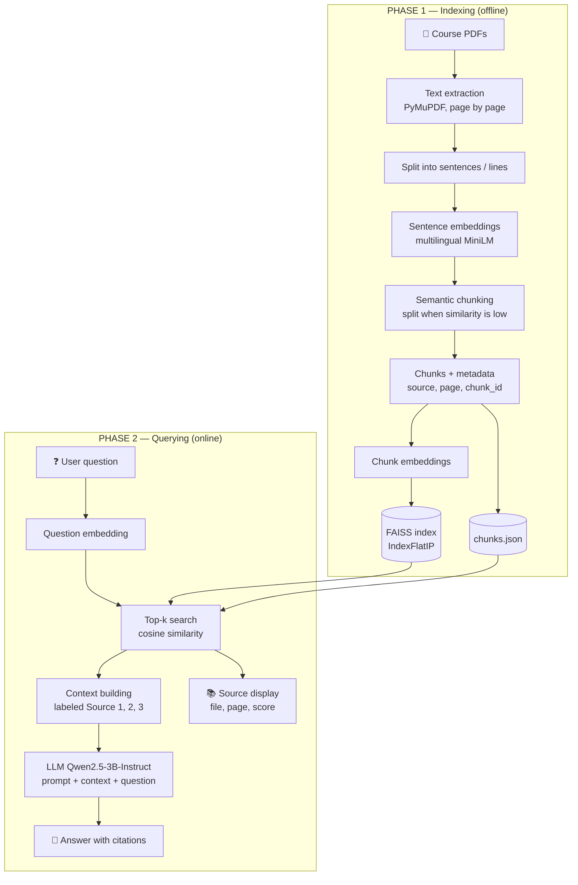

# 📚 RAG Assistant for the Information Retrieval Course

> A **Retrieval-Augmented Generation (RAG)** system that answers questions about course PDFs
> and **shows which document and which page each piece of information comes from**.

| | |
|---|---|
| **Student(s)** | *Meroua Amina Bouhmidi* |

---

## 📌 Table of Contents
1. [Context and Goal](#-context-and-goal)
2. [Features](#-features)
3. [System Architecture](#-system-architecture)
4. [Component Details](#-component-details)
5. [Semantic Chunking](#-semantic-chunking-algorithm)
6. [Generation and Source Display](#-generation-and-source-display)
7. [Technologies](#-technologies)
8. [Project Structure](#-project-structure)
9. [Installation and Usage](#-installation-and-usage)
10. [Example](#-example)
11. [Tunable Parameters](#-tunable-parameters)
12. [Limitations and Future Work](#-limitations-and-future-work)

---

## 🎯 Context and Goal
Students often have to search several PDF files to find one definition. Standalone LLMs may
"hallucinate" or answer outside the course content. This project uses RAG so that the model answers
**only from the course documents**, with **verifiable sources**.

Corpus: 8 IR course PDFs (domain definition, introduction, Boolean / vector / p-norm / LSI models,
performance evaluation), for a total of **225 pages**.

## ✨ Features
- Text extraction from multiple PDFs, page by page
- **Semantic chunking**: chunks follow topic changes
- **Multilingual** embeddings (French supported)
- Fast vector search with **FAISS**
- Answer generation with a local LLM (**Qwen2.5-3B-Instruct**)
- **Source display**: file name, page, similarity score, and passage preview
- The model cites `[Source n]` in its answer and admits when the information is missing

## 🏗️ System Architecture

The system works in **two phases**: indexing (done once), then querying (for every question).



### Data flow summary
```
PDF → pages → sentences → semantic chunks → vectors → FAISS
Question → vector → top-k chunks → prompt → LLM → answer + sources
```

## 🧩 Component Details

| Step | Component | Role | Input → Output |
|---|---|---|---|
| 1 | **PyMuPDF** | Extract text from each page | PDF → list of `{text, source, page}` |
| 2 | **Unit splitting** | Sentences / slide lines, merge units that are too short | text → units |
| 3 | **Semantic chunking** | Group units that talk about the same topic | units → chunks |
| 4 | **Sentence-Transformers** `paraphrase-multilingual-MiniLM-L12-v2` | Turn text into 384-dimensional vectors | text → vector |
| 5 | **FAISS** `IndexFlatIP` | Nearest-neighbor search (inner product = cosine, since vectors are normalized) | query vector → top-k positions |
| 6 | **Retriever** | Returns chunks with their source, page and score | question → chunks |
| 7 | **Qwen2.5-3B-Instruct** | Generates the answer from the context only | prompt → text |
| 8 | **Source display** | Shows where each piece of information comes from | chunks → readable list |

### Metadata kept for each chunk
```json
{
  "text": "The vector model represents documents and queries as vectors...",
  "source": "3. modeles-RI-1.pdf",
  "page": 12,
  "chunk_id": 0
}
```
This is what makes answers **traceable**: each one can be checked in the original document.

## ✂️ Semantic Chunking (algorithm)

Fixed-size splitting sometimes cuts in the middle of an idea. Here, we cut **when the topic changes**.

1. A page's text is split into **units** (sentences or lines); units that are too short are merged.
2. Each unit is turned into an embedding.
3. Units are added one by one to the current chunk. For each new unit, we compute the
   **cosine similarity** with the **centroid (mean)** of the current chunk.
4. A **new chunk** is started if:
   - the similarity is `< similarity_threshold` (topic change) **and** the chunk has at least `min_chars` characters, or
   - the chunk would exceed `max_chars`.

```
Units :   u1  u2  u3 │ u4  u5 │ u6  u7  u8
Sim.  :   .8  .7  .3 │ .8  .2 │ .7  .8  .7
Chunks:   [ chunk 1 ]  [chunk 2] [  chunk 3  ]
                    ↑ split            ↑ split
```

Chunks never span two pages, which keeps **page citations exact**.

## 🧾 Generation and Source Display

Each passage sent to the LLM is labeled:
```
[Source 1 — 3. modeles-RI-1.pdf, page 12]
<chunk text>
```
The *system prompt* requires the model to:
- answer **only** from the provided context;
- cite `[Source n]`;
- say clearly when the answer is not in the context (reduces hallucinations).

After the answer, the **📚 SOURCES USED** block lists the file, page, score and a preview.

## 🛠️ Technologies
| Area | Tool |
|---|---|
| Language | Python 3 |
| PDF extraction | PyMuPDF |
| Embeddings | Sentence-Transformers (`paraphrase-multilingual-MiniLM-L12-v2`) |
| Vector store | FAISS (CPU) |
| LLM | Qwen2.5-3B-Instruct (Hugging Face Transformers) |
| Environment | Google Colab / Jupyter Notebook |

## 📁 Project Structure
```
.
├── RAG_pipeline_semantic.ipynb   # main notebook (full pipeline)
├── data/
│   └── documents/                # course PDFs
├── requirements.txt              # dependencies
├── .gitignore
└── README.md
```
Files generated at runtime (not versioned): `rag_index.faiss`, `chunks.json`.

## 🚀 Installation and Usage

### Option A — Google Colab (recommended)
1. Open `RAG_pipeline_semantic.ipynb` in Colab.
2. `Runtime > Change runtime type > T4 GPU`.
3. Run all cells, then upload the PDFs when prompted (or place them in `data/documents/`).

### Option B — Local
```bash
git clone https://github.com/<username>/<repo>.git
cd <repo>
python -m venv .venv
source .venv/bin/activate        # Windows: .venv\Scripts\activate
pip install -r requirements.txt
# copy your PDFs into data/documents/
jupyter notebook RAG_pipeline_semantic.ipynb
```
> Qwen2.5-3B needs about 7 GB of memory; a GPU is strongly recommended.

## 💡 Example
```python
answer, docs = rag_answer("Qu'est-ce que le modèle vectoriel ?")
```
```
❓ Question: Qu'est-ce que le modèle vectoriel ?

💬 Answer:
The vector model represents documents and queries as vectors... [Source 1]

📚 SOURCES USED
[Source 1] 📄 3. modeles-RI-1.pdf | page 12 | score = 0.712
[Source 2] 📄 3.1 difference entre modèle booléen et le modèle vectoriel.pdf | page 3 | score = 0.668
```
*(Replace with a real screenshot of your run: `docs/demo.png`.)*

## ⚙️ Tunable Parameters
| Parameter | Role | Default |
|---|---|---|
| `similarity_threshold` | Semantic split threshold (higher = smaller chunks) | 0.45 |
| `min_chars` | Minimum chunk size | 250 |
| `max_chars` | Maximum chunk size | 1200 |
| `top_k` | Number of retrieved chunks | 3 |
| `max_new_tokens` | Maximum answer length | 300 |


